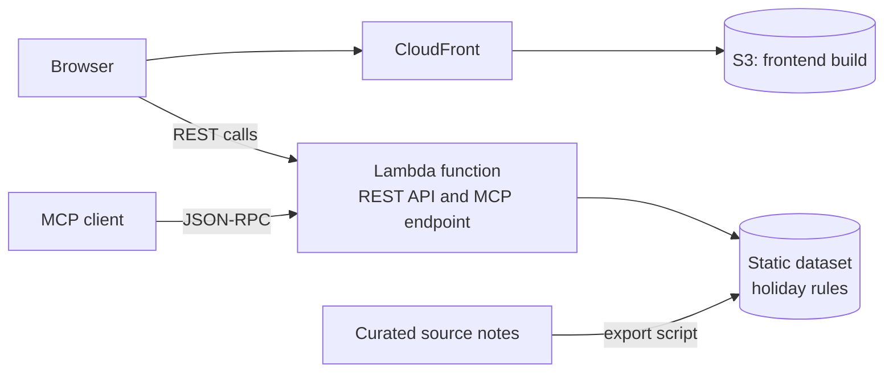

# Holiday Atlas

Holiday Atlas is a free public API, an MCP server and a web app for the public holidays of 210 countries. It runs at <https://holiday-atlas.rafikadiche.com>.

The data is curated by hand and stored as recurring rules, such as a fixed date, an offset from Easter or a date on the Hijri calendar. Each rule is resolved for the year a client asks for, so the data does not go stale from one year to the next.

This repository is the public documentation of the application: what it does, how it is designed and built, and how its quality is checked. The source code repositories are private.

This project is part of a portfolio. The [portfolio documentation](https://github.com/rafikadiche-portfolio-org/documentation) presents the technical profile behind it and the other projects.

## At a glance

| Area | Summary |
|---|---|
| Product | Public holiday web app, public REST API and MCP server for 210 countries |
| Frontend | Next.js 16 (App Router, static export), React 19, TypeScript, Tailwind CSS 4, D3 canvas globe |
| Backend | Node.js 20 on AWS Lambda (container image), TypeScript, zod, Model Context Protocol, OpenAPI 3 |
| Data | Static dataset of 2,368 holiday rules across the Gregorian, Hijri, Hebrew and Chinese calendars |
| Infrastructure | Terraform, Amazon CloudFront, S3, Lambda function URL, ECR, Route 53, ACM |
| Quality | Vitest, React Testing Library, Playwright on four browser projects, axe-core accessibility scans, GitHub Actions CI/CD, performance budget |
| Design | Design tokens, light and dark themes, responsive layout, English and French |

## Architecture

The site is a static export served from S3 through CloudFront. The browser calls the API directly on its own public address. The API reads a dataset that ships inside the function, so there is no database. [Architecture](02-technical/architecture.md) has the detail.

## Documentation map

Functional specifications

- [Overview](01-functional/overview.md): the problem, the users, the features and the rules behind the dates.
- [Use cases](01-functional/use-cases.md): actors, use cases and user journeys.
- [UX design](01-functional/ux-design.md): audiences, design tokens, screens and design decisions.

Technical specifications

- [Architecture](02-technical/architecture.md): how the parts fit together and why.
- [Frontend](02-technical/frontend.md): the Next.js application and its canvas globe.
- [Backend](02-technical/backend.md): the rule engine, the API and the dataset pipeline.
- [Infrastructure](02-technical/infrastructure.md): the AWS resources and how Terraform manages them.
- [API reference](02-technical/api-reference.md): REST routes, MCP tools and how to connect a client.

Quality

- [Testing](03-quality/testing.md): unit and end-to-end tests, coverage, and the status of each repository.
- [Audit](03-quality/audit.md): performance, accessibility and code quality results.
- [Security](03-quality/security.md): the security controls, by category.
- [Operations](03-quality/operations.md): health checks, deployment and data updates.

## Skills and where they are shown

| Area | Skills | Pages |
|---|---|---|
| UI and UX design | User journeys, design tokens, interaction states, data visualization on a globe, responsive design, accessibility, UX writing | [Use cases](01-functional/use-cases.md), [UX design](01-functional/ux-design.md) |
| Frontend development | React, Next.js, TypeScript, Tailwind CSS, D3, HTML canvas, internationalization, code splitting, web performance | [Frontend](02-technical/frontend.md) |
| Backend development | Node.js, TypeScript, REST API design, OpenAPI, MCP server, calendar algorithms, data modelling, schema validation | [Backend](02-technical/backend.md), [API reference](02-technical/api-reference.md) |
| Cloud and DevOps | AWS serverless, Docker, Terraform, infrastructure as code, GitHub Actions, CI/CD, cost control | [Infrastructure](02-technical/infrastructure.md), [Operations](03-quality/operations.md) |
| Quality and security | Unit testing, component testing, end-to-end testing, cross-browser testing, WCAG 2.1 AA, performance budgets, rate limiting | [Testing](03-quality/testing.md), [Audit](03-quality/audit.md), [Security](03-quality/security.md) |

## Repositories

| Repository | Role | Visibility |
|---|---|---|
| `frontend` | Next.js static site: the globe, the country search and the holiday calendar | Private |
| `backend` | The rule engine, the REST API, the MCP endpoint and the dataset scripts | Private |
| `infrastructure` | Terraform for the site, the function and the budget alert | Private |
| `documentation` | This repository | Public |

## Scope of this documentation

The pages describe patterns and the public interface. They leave out resource identifiers, access policies and operating procedures, which stay in the private repositories. Measured results carry the date they were taken.

## Questions

[adicherafik@gmail.com](mailto:adicherafik@gmail.com)
